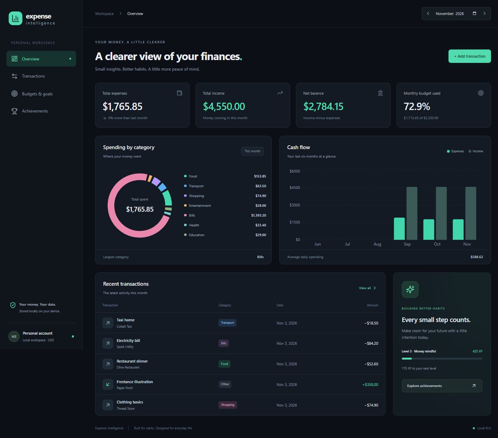

# Expense Intelligence

A local-first personal finance app for understanding spending, reviewing transaction exports, and tracking monthly budgets. I built it as Day 1 of my 30-day software engineering challenge.

## Features

- Add, edit, delete, search, filter, and sort income and expenses.
- Preview CSV imports before saving, with duplicate detection and row-level errors.
- Categorize transactions through configurable keyword rules or manual selections.
- View monthly totals, category breakdowns, six-month trends, and daily averages.
- Track category budgets with warnings at 80% and clear overspending indicators.
- Unlock six achievements with persisted, one-time XP rewards.
- Responsive dark interface with keyboard-friendly forms and dialogs.

Amounts are stored as integer cents in SQLite. The app runs locally without bank connections, authentication, or paid services. Currency is USD.

## Stack

**Frontend:** React, TypeScript, Vite, Tailwind CSS, Recharts, Motion, Lucide.

**Backend:** Python 3.12+, FastAPI, Pydantic, SQLAlchemy, Pandas, SQLite.

**Testing and deployment:** Pytest, Docker Compose, Nginx.

## Run with Docker

```sh
docker compose up --build
```

Open [localhost:8080](http://localhost:8080). The API runs on port 8000; [Swagger](http://localhost:8000/docs) documents the endpoints. SQLite persists in a named Docker volume.

To load the included fictional transactions and budgets:

```sh
docker compose exec backend python seed.py
```

The loader is safe to repeat. Demo transactions span September–November 2026.

## Local Development

Requires Python 3.12+ and Node.js 22.

```sh
cd backend
python -m venv .venv
```

Activate with `.venv\Scripts\activate` on Windows or `source .venv/bin/activate` on macOS/Linux, then:

```sh
python -m pip install -r requirements.txt
python -m uvicorn app.main:app --reload
```

In a second terminal:

```sh
cd frontend
npm ci
npm run dev
```

Open [localhost:5173](http://localhost:5173). Local data lives in `backend/data/expenses.db`; tables initialize on startup. Environment settings are listed in `.env.example`.

## CSV Imports

UTF-8 CSV, up to 2 MB and 5,000 rows:

```csv
date,description,merchant,amount,type,category
2026-11-02,Weekly groceries,Green Market,48.75,expense,Food
```

`merchant` and `category` are optional. Amounts must be positive with at most two decimal places; type is `income` or `expense`. Categories: Food, Transport, Shopping, Entertainment, Bills, Health, Education, Other.

Blank categories use `backend/app/category_rules.json`. Duplicate matching compares date, normalized description and merchant, cents, and type. Identical legitimate charges need distinct descriptions. Examples are in `sample_data/`.

## Tests

```sh
cd backend
python -m pytest -q
cd ../frontend
npm run build
```

The backend suite covers categorization, analytics, budgets, CSV validation, concurrent imports, API requests, and achievement persistence.

## Screenshots



[Mobile dashboard](screenshots/overview-mobile.jpg) · [CSV import preview](screenshots/csv-preview.jpg)
